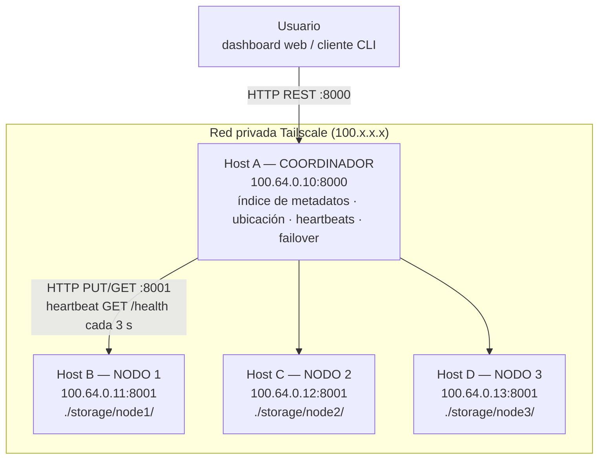

# DFS-UTP — Sistema Distribuido de Almacenamiento de Archivos

Pequeño **sistema distribuido de almacenamiento de archivos** desarrollado para el *Taller Parcial – Laboratorio de Sistemas Distribuidos* de la **Universidad Tecnológica de Pereira**, Ingeniería de Sistemas y Computación, octubre de 2026.

Cuatro hosts independientes —un coordinador y tres nodos de almacenamiento— colaboran por red para que el usuario suba y descargue archivos como si hablara con **un solo servicio**. Cada archivo se guarda en **dos nodos diferentes**. Si uno de ellos se cae, el archivo se sigue entregando desde la otra réplica.

**Integrantes:** Jorge Pineda · Alan Giraldo · Juan García · Juan Cano
**Docente:** Alexander Bejarano

---

## Arquitectura



> Las IP del diagrama son de ejemplo. Deben reemplazarse por las IP reales de Tailscale en [`docs/DESPLIEGUE.md`](docs/DESPLIEGUE.md) y en [`config/nodes.json`](config/nodes.json).

| Componente | Responsabilidad |
|---|---|
| **Coordinador** (`coordinator/`) | Punto de entrada único. Decide en qué nodos se guarda cada archivo, mantiene el índice archivo → nodos (`metadata.json`), vigila los nodos con heartbeats, entrega descargas desde cualquier réplica viva y re-replica bajo demanda. Dashboard web en `/`. |
| **Nodo de almacenamiento** (`node/`) | Guarda las réplicas como archivos reales en su propio disco (`./storage/<node_id>/`), verifica el SHA-256 al escribir y entrega archivos e información de salud. |
| **Cliente** (`client/dfs.py`) | CLI para subir, descargar, listar, localizar y reparar. Incluye el modo `direct`, usado en el análisis de caída del coordinador. |

## Características principales

- **Transparencia de ubicación:** el usuario nunca elige un nodo; lo decide el coordinador.
- **Factor de replicación 2:** cada archivo vive en dos hosts distintos (configurable).
- **Ubicación determinística:** el nombre del archivo se aplica a un anillo hash de nodos. Los siguientes nodos vivos en sentido horario reciben las réplicas.
- **Detección de fallos:** heartbeat a `GET /health` cada 3 s. Los fallos también se detectan en el momento de una lectura o escritura.
- **Failover:** las descargas saltan las réplicas caídas y se entregan desde una que sobrevive. El encabezado `X-Served-By` indica qué nodo respondió.
- **Integridad:** el SHA-256 se calcula al subir, cada nodo lo verifica al escribir y el cliente lo verifica después de descargar.
- **Reparación:** `POST /repair` copia los archivos que perdieron una réplica a otro nodo vivo y restaura el factor de replicación.
- **Pensado para evidencias:** cada nodo registra `STORED / SERVED / MISS` con la IP remota, y el coordinador mantiene un registro de eventos visible en el dashboard.

## Inicio rápido

Requisito: Python 3.10+ en cada host.

```bash
git clone https://github.com/Juandagarc/dfs-utp.git
cd dfs-utp
pip install -r requirements.txt
```

**Hosts B, C y D (nodos de almacenamiento)**

```bash
./scripts/start_node.sh node1          # node2 en el Host C, node3 en el Host D
# Windows: .\scripts\start_node.ps1 -NodeId node1
```

**Host A (coordinador).** Primero se escriben las IP de los nodos en `config/nodes.json`:

```bash
./scripts/start_coordinator.sh
# Windows: .\scripts\start_coordinator.ps1
```

Después se abre el dashboard en `http://<ip-coordinador>:8000`, o se usa el CLI desde cualquier host:

```bash
export DFS_COORDINATOR=http://<ip-coordinador>:8000     # Windows: $env:DFS_COORDINATOR="http://..."
python client/dfs.py nodes
python client/dfs.py upload informe.pdf
python client/dfs.py ls
python client/dfs.py download informe.pdf -o copia.pdf
```

El despliegue completo paso a paso (Tailscale, firewall, prueba de conectividad) está en **[docs/DESPLIEGUE.md](docs/DESPLIEGUE.md)**.

## Documentación

| Documento | Contenido |
|---|---|
| [docs/ARQUITECTURA.md](docs/ARQUITECTURA.md) | Decisiones de diseño (sección 7 de la guía): propósito, nodos, comunicación, datos, distribución, replicación, fallos |
| [docs/DESPLIEGUE.md](docs/DESPLIEGUE.md) | Tabla de infraestructura, configuración de cada máquina, conectividad, solución de problemas |
| [docs/ANALISIS_FALLOS.md](docs/ANALISIS_FALLOS.md) | Caída de un nodo, caída del coordinador (SPOF), escalar a 100 nodos, pregunta central |
| [docs/GUION_VIDEO.md](docs/GUION_VIDEO.md) | Guion del video por integrante y lista de verificación para la evaluación en vivo |
| [docs/BITACORA_PLANTILLA.md](docs/BITACORA_PLANTILLA.md) | Estructura de la bitácora y lista de pantallazos que se deben tomar |

## API HTTP

| Método | Ruta | Componente | Descripción |
|---|---|---|---|
| GET | `/` | Coordinador | Dashboard web |
| POST | `/upload` | Coordinador | Subida multipart; devuelve las réplicas elegidas |
| GET | `/download/{name}` | Coordinador | Entrega el archivo desde una réplica viva (encabezado `X-Served-By`) |
| GET | `/files` | Coordinador | Archivos con la ubicación y el estado de sus réplicas |
| GET | `/locate/{name}` | Coordinador | URL exactas de los nodos que tienen un archivo |
| GET | `/nodes` | Coordinador | Estado y estadísticas de cada nodo |
| POST | `/repair` | Coordinador | Restaura el factor de replicación |
| DELETE | `/files/{name}` | Coordinador | Borra un archivo de todas sus réplicas |
| GET | `/health` | Nodo | Heartbeat: hostname, número de archivos, bytes, tiempo activo |
| GET | `/files` | Nodo | Archivos físicamente presentes en este host (con SHA-256) |
| PUT / GET / DELETE | `/files/{name}` | Nodo | Guardar / leer / borrar una réplica |

Cada componente genera documentación interactiva de su API en `/docs`.

## Estructura del repositorio

```
dfs-utp/
├── coordinator/
│   ├── main.py             # servicio coordinador
│   └── dashboard.html      # dashboard web en vivo
├── node/
│   └── main.py             # servicio del nodo de almacenamiento
├── client/
│   └── dfs.py              # cliente de línea de comandos
├── config/
│   ├── nodes.json          # despliegue REAL: IP de los nodos (editar)
│   └── nodes.local.json    # solo para desarrollo local
├── scripts/                # arranque, firewall y conectividad (bash + PowerShell)
├── tests/
│   └── test_e2e.py         # prueba automática de toda la secuencia del laboratorio
└── docs/                   # documentación en español + carpeta de pantallazos
```

## Cómo se cumple cada requisito de la guía

| Requisito (sección de la guía) | Dónde / cómo |
|---|---|
| Máquinas independientes con IP diferentes (3, 4) | 4 hosts en una red Tailscale — [DESPLIEGUE.md](docs/DESPLIEGUE.md) |
| Diseño antes de programar (7) | [ARQUITECTURA.md](docs/ARQUITECTURA.md) |
| Tabla de infraestructura (8) | [DESPLIEGUE.md § 1](docs/DESPLIEGUE.md#1-inventario-de-infraestructura) |
| Prueba de conectividad (9) | `ping` + `python scripts/check_connectivity.py` |
| El usuario percibe un solo servicio (10) | Solo se usa la URL del coordinador; la ubicación es automática |
| La información existe realmente en los nodos (11) | Archivos en `./storage/<nodo>/` de cada host; `GET /files` en el nodo los lista con SHA-256 |
| Distribución y replicación (12) | Anillo hash, factor de replicación 2 |
| Prueba obligatoria de fallo (13) | Se detiene un nodo → la descarga sigue funcionando y `X-Served-By` muestra la réplica |
| Análisis de caída del coordinador (14) | [ANALISIS_FALLOS.md](docs/ANALISIS_FALLOS.md), `dfs.py direct` |
| Evidencias (15) | [BITACORA_PLANTILLA.md](docs/BITACORA_PLANTILLA.md), registro de eventos del dashboard, logs de los nodos |

## Pruebas

```bash
python tests/test_e2e.py
```

Esta prueba levanta los 4 componentes como procesos locales y verifica la secuencia completa: subida, distribución, archivos físicos, caída de nodo, failover, reparación y caída del coordinador. **Es solo una verificación de desarrollo.** La demostración evaluada debe correr en 4 hosts separados, como exige la sección 3 de la guía. `scripts/local_simulation.sh` existe con el mismo fin: probar el código antes de desplegarlo.
